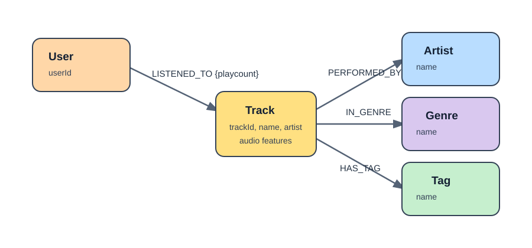
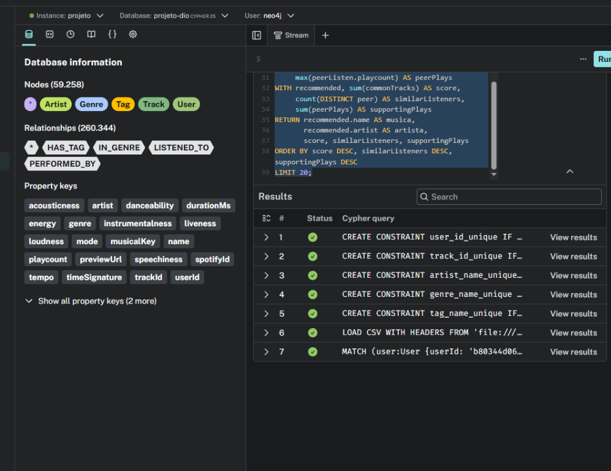
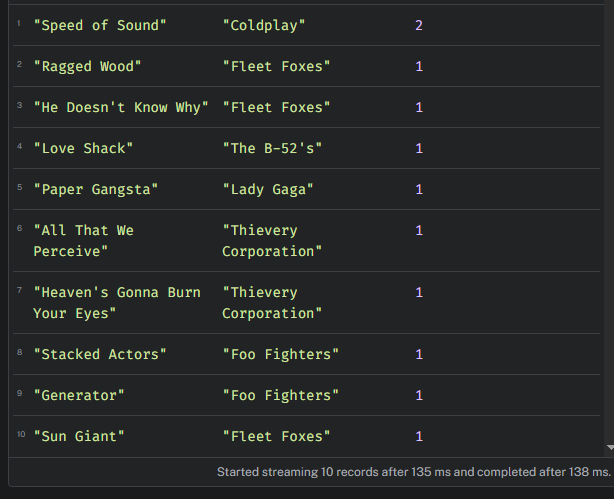
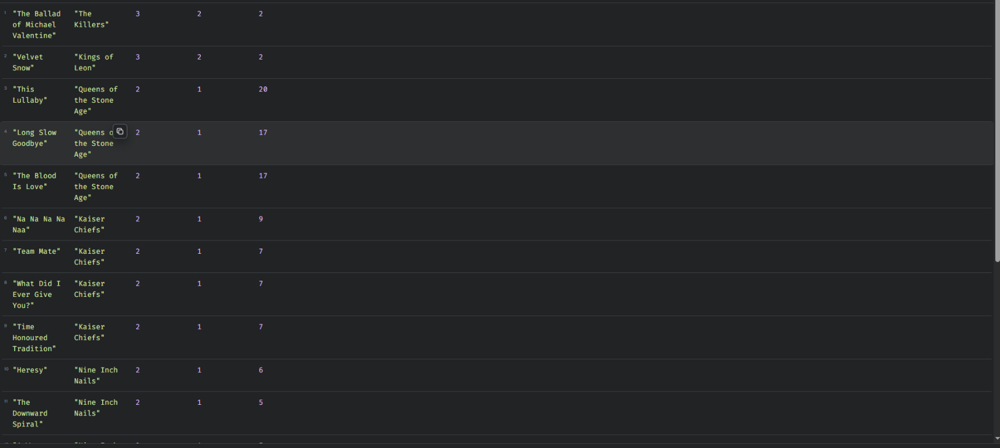
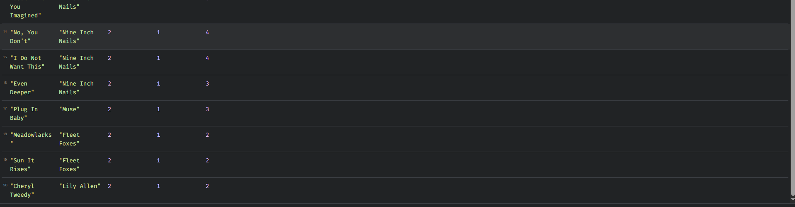
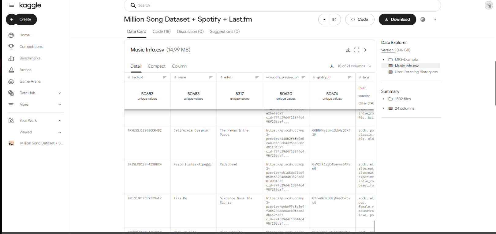
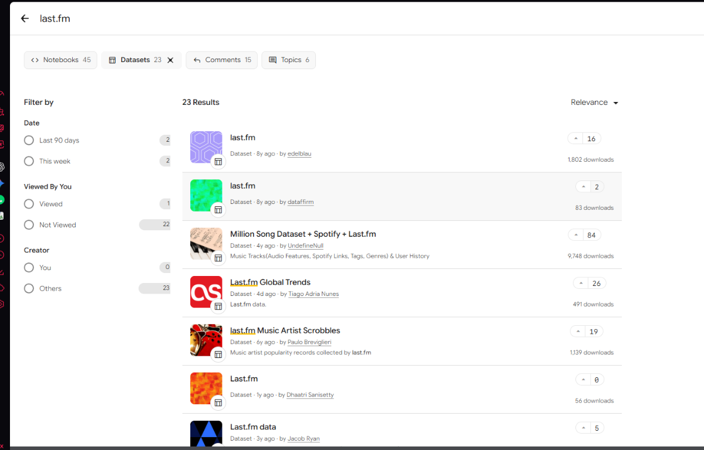

<p align="center">
  
</p>

<h1 align="center">Recomendação de Músicas com Neo4j</h1>

<p align="center">
  Um projeto de banco de dados em grafo que transforma históricos de audição
  em recomendações musicais explicáveis.
</p>

<p align="center">
  
  
  
  
</p>

<p align="center">
  <a href="#sobre-o-projeto">Sobre</a> ·
  <a href="#modelo-do-grafo">Modelo</a> ·
  <a href="#como-executar">Como executar</a> ·
  <a href="#evidências">Evidências</a> ·
  <a href="#dados-e-atribuição">Dados</a>
</p>

## Sobre o projeto
## Formação e autoria

Projeto desenvolvido por **Kennedy Anderson**, em **2026**, como atividade prática do bootcamp **Neo4j - Certification**, realizado pela **DIO em parceria com a Neo4j**.

**Instrutor:** Matheus Ferreira — Engenheiro de Dados Neo4j.


Este projeto usa o **Neo4j** para explorar relações entre pessoas, músicas, artistas, gêneros e tags. A partir do histórico de audições, o grafo responde perguntas como:

- Que faixas podem interessar a uma pessoa com base em ouvintes de gostos parecidos?
- Que músicas compartilham artista, gênero ou tags?
- Quais faixas são mais populares no histórico?

O foco é uma recomendação colaborativa: encontrar ouvintes que compartilham músicas com a pessoa consultada e sugerir faixas que ela ainda não ouviu. O repositório também inclui uma consulta de recomendação por tags e uma consulta de popularidade.

## Modelo do grafo

<p align="center">
  
</p>

As audições conectam usuários a faixas e guardam a quantidade de reproduções. Os metadados conectam cada faixa a artistas, gêneros e tags.

```text
(:User)-[:LISTENED_TO {playcount}]->(:Track)
(:Track)-[:PERFORMED_BY]->(:Artist)
(:Track)-[:IN_GENRE]->(:Genre)
(:Track)-[:HAS_TAG]->(:Tag)
```

O campo `track_id` integra os arquivos de dados. Uma faixa pode existir no histórico sem ter metadados correspondentes; nesse caso, ela permanece no grafo, mas não aparece nas recomendações que precisam exibir seu nome.

## Como executar

### O que você precisa

- Neo4j Desktop e um banco local iniciado.
- Os arquivos CSV na pasta `import` **do DBMS** — não em uma pasta `import` criada dentro deste projeto.
- Os scripts Cypher deste repositório.

### 1. Prepare os arquivos

Copie `data/music_info.csv` para a pasta `import` do DBMS. Para começar com um conjunto menor, copie também `data/samples/listening_history_sample.csv` para essa pasta e renomeie a cópia para **`listening_history.csv`**.

> O nome precisa ser exatamente `listening_history.csv`, pois é o arquivo indicado no script de carga. No Windows, confira se a extensão `.csv` não ficou duplicada ou oculta.

Para carregar o histórico completo, obtenha o arquivo na fonte indicada em [Dados e atribuição](#dados-e-atribuição) e use-o no lugar da amostra.

### 2. Carregue os dados

No Neo4j Desktop, inicie o banco correto e abra o **Query** conectado a ele. Abra e execute os scripts abaixo **na ordem**, um de cada vez:

1. [`01_constraints.cypher`](code/cypher/01_constraints.cypher) — cria as restrições de unicidade.
2. [`02_import_tracks.cypher`](code/cypher/02_import_tracks.cypher) — carrega faixas e metadados.
3. [`03_import_listening_history.cypher`](code/cypher/03_import_listening_history.cypher) — carrega usuários e audições.

Se você tiver mais de um banco, confirme no Query que está conectado ao banco em que deseja carregar os dados.

### 3. Gere recomendações

Abra [`04_business_queries.cypher`](code/cypher/04_business_queries.cypher) e execute a consulta colaborativa. Para reproduzir a consulta de demonstração usando um usuário presente na amostra, use:

```cypher
MATCH (user:User {userId: 'b80344d063b5ccb3212f76538f3d9e43d87dca9e'})-[:LISTENED_TO]->(seed:Track)
      <-[:LISTENED_TO]-(peer:User)-[peerListen:LISTENED_TO]->(recommended:Track)
WHERE peer <> user
  AND recommended.name IS NOT NULL
  AND NOT EXISTS { MATCH (user)-[:LISTENED_TO]->(recommended) }
WITH peer, recommended, count(DISTINCT seed) AS commonTracks,
     max(peerListen.playcount) AS peerPlays
WITH recommended, sum(commonTracks) AS score,
     count(DISTINCT peer) AS similarListeners,
     sum(peerPlays) AS supportingPlays
RETURN recommended.name + ' - ' +
       coalesce(recommended.artist, 'Artista desconhecido') AS recommendation,
       score, similarListeners, supportingPlays
ORDER BY score DESC, similarListeners DESC, supportingPlays DESC
LIMIT 20
```

O `score` representa a quantidade agregada de faixas em comum com ouvintes semelhantes; **não é uma probabilidade**. O resultado também informa quantos ouvintes semelhantes apoiam a recomendação e as reproduções de apoio.

## Evidências

As capturas abaixo mostram a carga e os resultados obtidos no Neo4j Desktop com a amostra de audições.

<details>
  <summary><strong>Ver grafo carregado e resultados das consultas</strong></summary>
  <br>
  <p><strong>Grafo musical carregado</strong></p>
  
  <p><strong>Faixas e reproduções do usuário de teste</strong></p>
  
  <p><strong>Recomendações colaborativas</strong></p>
  
  <p><strong>Continuação das recomendações</strong></p>
  
</details>

<details>
  <summary><strong>Ver capturas da origem do dataset</strong></summary>
  <br>
  <p><strong>Página do dataset no Kaggle</strong></p>
  
  <p><strong>Busca do dataset no Kaggle</strong></p>
  
</details>

## Dados e atribuição

O projeto usa o dataset [Million Song Dataset + Spotify + Last.fm](https://www.kaggle.com/datasets/undefinenull/million-song-dataset-spotify-lastfm), publicado por **UndefineNull** no Kaggle. A página do dataset indica a licença [CC BY-NC 4.0 — Atribuição-NãoComercial](https://creativecommons.org/licenses/by-nc/4.0/).

| Arquivo | Conteúdo |
| --- | --- |
| `data/music_info.csv` | Metadados das faixas, incluindo artista, gênero, tags e características de áudio. |
| `data/samples/listening_history_sample.csv` | Amostra reduzida do histórico para testar a carga. |
| `data/listening_history.csv` | Histórico completo; arquivo local de aproximadamente 603 MB, ignorado pelo Git. |

O histórico completo não é incluído no repositório por seu tamanho. Este projeto mantém a atribuição e destina-se a estudo e uso não comercial. Consulte a licença original antes de redistribuir os dados ou utilizá-los comercialmente.

## Estrutura do repositório

```text
code/
  cypher/          Restrições, importação e consultas de negócio
  python/          Exemplo de cliente Python
  javascript/      Exemplo de cliente JavaScript
  java/            Exemplo de cliente Java
  csharp/          Exemplo de cliente C#
  go/              Exemplo de cliente Go
data/
  samples/         Amostra do histórico de audições
documentation/
  img/             Diagrama do grafo e capturas de evidência
graphql/           Esquema e exemplo da API GraphQL
```

Os exemplos de clientes e a API GraphQL são alternativas para consultar o banco; para começar, basta seguir os passos do Neo4j Desktop acima. Veja também o [guia de recomendações](documentation/recommendations.adoc) para detalhes do modelo, das consultas e da solução de problemas.


## Limitações e próximos passos

- O histórico registra reproduções, não avaliações explícitas; `playcount` é apenas um sinal de interesse.
- A recomendação colaborativa depende de usuários e faixas em comum. Um usuário com pouca sobreposição pode não receber resultados.
- A amostra serve para testar o fluxo, mas pode produzir menos recomendações que o histórico completo.
- Como evolução, é possível comparar pesos diferentes, criar uma estratégia alternativa baseada em tags e avaliar os resultados em dados separados.

## Solução de problemas

- **O CSV não é encontrado:** confirme a pasta `import` do DBMS e verifique se o nome do arquivo corresponde ao usado pelo script.
- **O nome do histórico não corresponde:** renomeie a cópia da amostra para `listening_history.csv`.
- **Erro em `CALL { ... } IN TRANSACTIONS`:** execute o script de importação em uma transação implícita, sem envolvê-lo em uma transação explícita.
- **Nenhuma recomendação aparece:** confirme que a carga terminou e que o usuário tem faixas em comum com outros usuários. A amostra é pequena; tente outro usuário ou o histórico completo.
- **O GitHub não aceita o histórico completo:** o arquivo é ignorado intencionalmente pelo `.gitignore`; publique apenas a amostra ou escolha uma forma de distribuição adequada ao tamanho e à licença.
